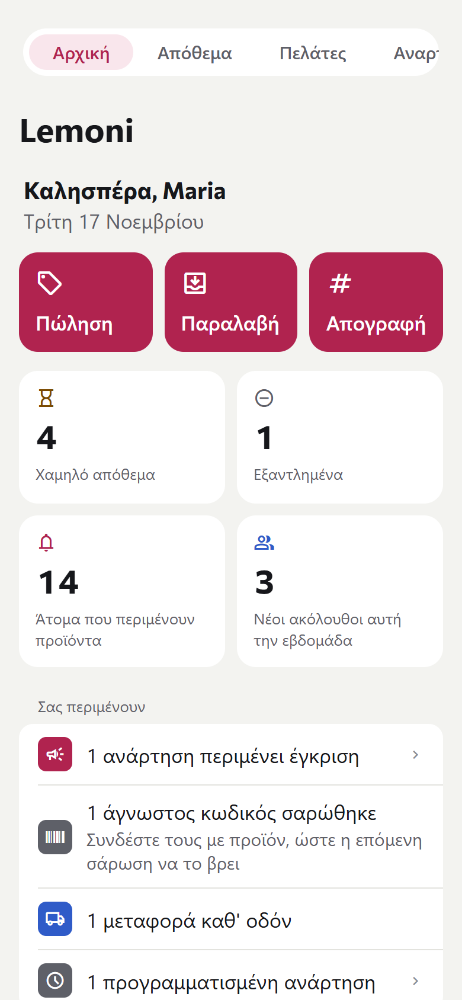
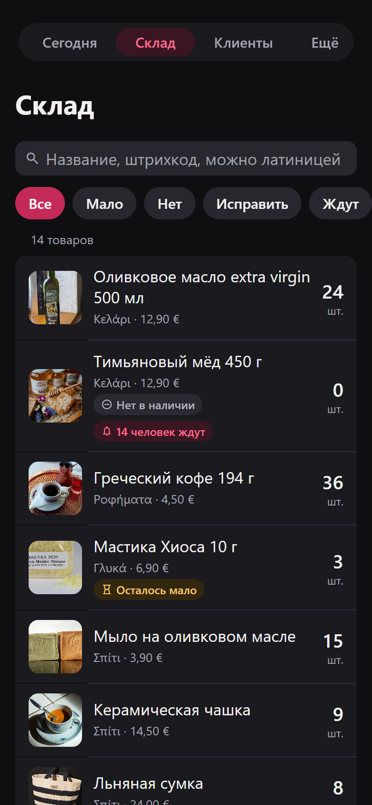
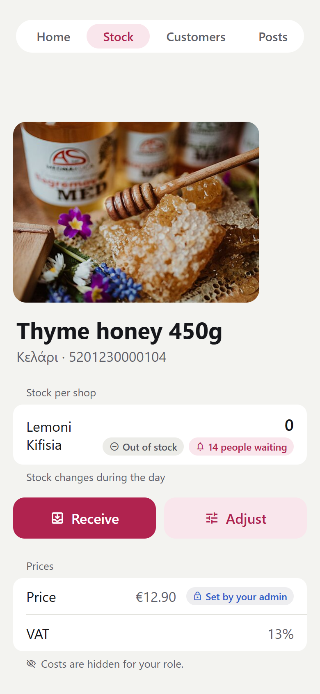
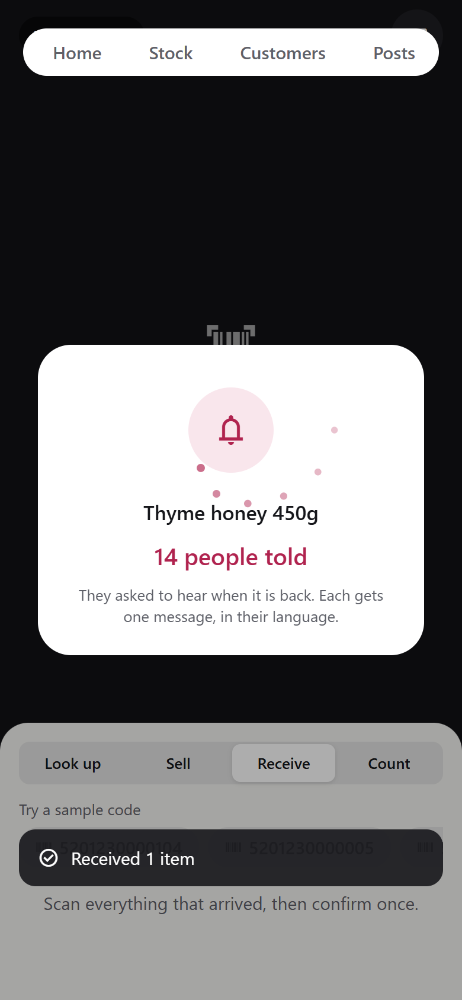
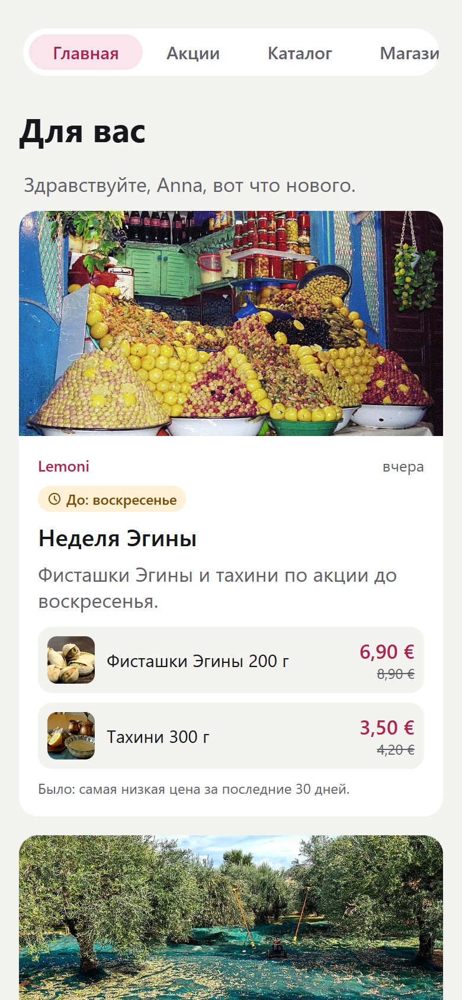
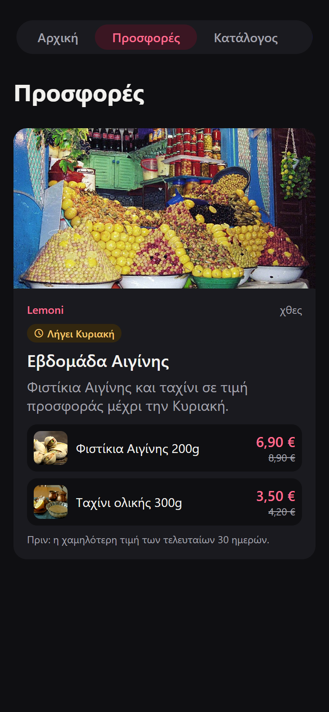
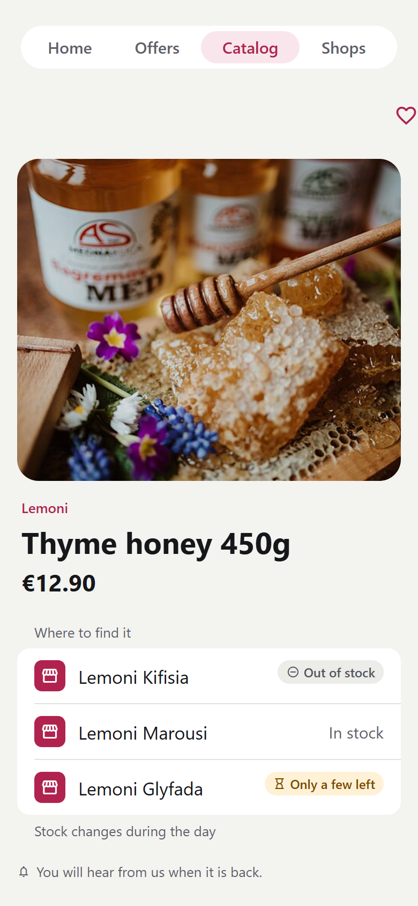
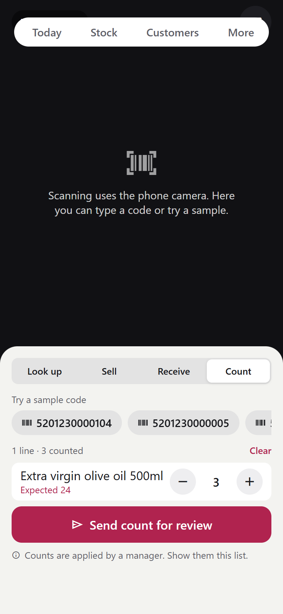

# Custock mobile

The phone app. One app with two sides: **work** (owners, admins, managers, staff, viewers) and
**my shops** (customers). Expo SDK 58, React Native 0.88, expo-router with native tabs, so the tab
bar, sheets and large titles are the real platform ones.

<table>
  <tr>
    <td width="25%"><br><sub>Manager home, Greek</sub></td>
    <td width="25%"><br><sub>Stock, staff, Russian, dark</sub></td>
    <td width="25%"><br><sub>Product: locked price, hidden cost</sub></td>
    <td width="25%"><br><sub>Receiving the honey: 14 people told</sub></td>
  </tr>
  <tr>
    <td width="25%"><br><sub>Customer feed, Russian</sub></td>
    <td width="25%"><br><sub>Offers with the 30 day "was" price</sub></td>
    <td width="25%"><br><sub>Availability per shop, as the merchant allows</sub></td>
    <td width="25%"><br><sub>Counting, sent to the manager for review</sub></td>
  </tr>
</table>

Screenshots are from the web build at phone size. On a phone the tab bar sits at the bottom and is
the system one.

## run it

```
pnpm install                      # from the repo root
pnpm dev:mobile                   # expo dev server, scan the QR with Expo Go or a dev build
```

Without an API url the app runs on built in demo data (`src/lib/fixtures.ts`): Lemoni, a deli
with three shops, with the same permission rules as the server. The sign in screen lists the demo
accounts. To use the real API:

```
EXPO_PUBLIC_API_URL=http://<your-ip>:8787 pnpm dev:mobile
```

For screenshots and quick checks on the web build, `/sign-in?as=maria&lang=el&next=/stock` signs
in as a demo account, sets the language and opens a screen.

## what is where

```
src/app/(work)/      tabs for members: home, stock, customers, posts, more, and scan
src/app/(shopper)/   tabs for customers: feed, offers, catalog, shops, profile
src/app/sheet/       short tasks as sheets: adjust stock, new product, invite, language
src/lib/             api (real client or demo data), session and permissions, i18n, push, formats
src/ui/              list sections and rows, buttons, the tally number, stock badges, the back in stock moment
```

Every string comes from `packages/i18n` (namespaces `common` and `mobile`) in English, Greek and
Russian. Permissions come from `/v1/me/context` and are checked with `can()` from `packages/core`.

## checks

```
pnpm --filter @custock/mobile typecheck
pnpm --filter @custock/mobile lint
pnpm --filter @custock/mobile test       # the demo data follows the server rules
npx expo export --platform web       # bundles, from apps/mobile
npx expo export --platform android
```

## builds

Local only. No CI/CD and no cloud builds. `npx expo prebuild` writes the native folders (they are
not committed), then build with Gradle or Xcode on the machine, or `npx expo run:android`. iOS
builds need a Mac.

On Windows the Android debug build currently stops in the C++ step of `react-native-worklets`:
the build folder path plus the source path go over the 260 character limit (`ninja: error: mkdir
... No such file or directory`). Two ways out: turn on long paths in Windows (needs admin), or
clone the repo to a short folder like `C:\cs\custock`. Gradle itself runs fine with the JDK that
ships with Android Studio.

## not done yet

- transfers have no screen on the phone yet. the push for "on the way" lands on home.
- push registration asks for permission after an explanation screen; sending a real push needs the
  FCM setup on the server.
- offline outbox (phase 5 in the roadmap) is not built.
- checked against the real api on a spare port: sign in, stock, product, customers, posts, the
  customer feed, offers and catalog all load. product names come in the business language there.
