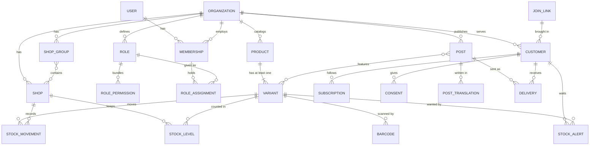

# 04. data model

The shape of the data. The full draft sql is in [db/schema.sql](db/schema.sql) (sqlite, 50 tables,
loads clean). This file explains it.

## conventions

**decided:**

| thing | how | why |
|-------|-----|-----|
| ids | uuid v7 as text | sortable by time, can be made on the phone while offline |
| time | integer, epoch ms, utc | no timezone bugs in storage. shown in the shop timezone |
| money | integer cents in the org currency | floats lose cents |
| quantity | integer in base units. pieces x1, kg/l/m x1000 | 0.25 kg of olives is 250, no floats |
| tenant | `org_id` on every business table, even child tables | every query can filter on it, and a missing filter is easy to spot in review |
| deletes | soft (`archived_at`, `deleted_at`, `erased_at`) | history must survive. hard delete only for gdpr and org deletion |
| emails | trimmed and lowercased on write | so unique indexes work without functions |
| phones | e164 | +30, +357, +7 all look the same way |
| scopes | `scope_type` + `scope_id` | one pattern for roles, subscriptions, join links, post audiences |

## the big picture

## areas

### platform
- **users**: anyone who logs in, staff or customer. the id comes from my auth server.
- **devices**: one per installed app, holds the fcm token. maybe on the auth server already.

### tenancy
- **organizations**: the business. currency, timezone, default language, policies.
- **shops**: locations. own timezone if different (a chain across greece and cyprus).
- **shop_groups** + **shop_group_shops**: many to many.

### access
- **roles** + **role_permissions**: per org, default ones copied in on creation.
- **memberships**: a user in an org, with a status and a `perms_version`.
- **role_assignments**: membership + role + scope. the heart of who can do what where.
- **invites**: only the token hash is stored. the plain token is in the email link.

### catalog
- **products** -> **product_variants** -> **barcodes**. a t-shirt is a product, "M black" is a
  variant, and that variant can have the factory EAN plus our own label.
- every product has at least one variant. single products just have one default variant that the
  ui hides. this keeps stock and barcodes in one place.
- **shop_variant_settings**: per shop price override, hidden flag, reorder point.
- **product_translations**: optional names in the other languages, phase 2.
- **unknown_scans**: codes that matched nothing, waiting for a manager.

### stock
- **stock_movements**: the ledger, append only, enforced by triggers. see [05](05-inventory.md).
- **stock_levels**: cached on hand per shop and variant, updated in the same transaction as the
  movement. can always be rebuilt by summing the ledger, and a nightly job checks they match.
- **stock_counts** + lines, **transfers** + lines.

### customers
- **customers**: per org. same person in two orgs is two rows that never meet.
- **customer_subscriptions**: who follows the org, a group or a shop. `pending` until confirmed.
- **consents**: append only proof. the `*_ok` columns on customers are just a cache of the latest.
- **customer_tags**, **customer_interests**, **customer_notes**.
- **join_links**: the QR codes. each one has a label so we know which poster works.
- **stock_alerts**: notify me when back.

### comms
- **posts** + **post_translations** + **post_products** + **post_media**.
- **post_scopes**: the scopes the post was sent to. the customer feed is "posts whose scopes I am
  subscribed to", which also means a new subscriber sees offers that are still running.
- **deliveries**: one row per customer per channel. it is both the send queue and the stats.
- **email_suppressions**: bounces and complaints, platform wide.

### reports
- **daily_shop_stats**, **daily_variant_stats**, **join_link_stats_daily**: rollups. updated
  as things happen and rebuilt nightly for the last few days. dashboards read these instead of
  summing the whole ledger every time. see [10](10-reports-and-analytics.md).

### audit and jobs
- **audit_log**: who changed what, with before and after. permission changes, prices, exports,
  erasures, support access.
- **jobs**: a tiny job queue in the database. sends, scheduled posts, rollups, cleanups. no redis,
  no extra service.

## things to watch

- **tenant isolation is the number one risk.** sqlite has no row level security. the plan:
  every repository function takes the org context as its first argument and builds the `org_id`
  filter itself. raw sql outside the repository layer is not allowed. tests try to read another
  org's data through every endpoint.
- **polymorphic scopes have no foreign keys.** when a shop is archived or a group deleted, the api
  cleans or keeps the matching assignments, subscriptions and join links on purpose. a nightly
  check reports orphans.
- **append only and org deletion.** deleting an org means dropping its rows, which the triggers
  block. org deletion runs as a special maintenance job that drops the triggers inside its
  transaction, or later we move to one database file per org (see [11](11-stack.md)).
- **sqlite text matching is ascii only** for case. `lower()` and `LIKE` do not fold greek or
  cyrillic. that is why `search_key` is computed in our code. see [09](09-languages.md).
